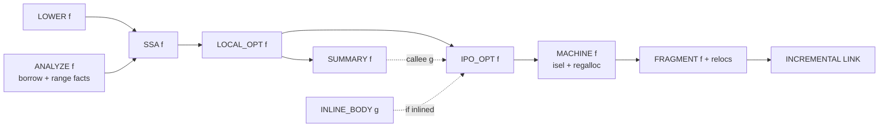

# Graph-native optimizer and code generation

Status: **decided direction, nothing implemented.** Decisions recorded 2026-10-18.
Tracker: `IMPLEMENTATION.md` G12.

## 1. Decision

The optimizer is written from scratch in Rust and embedded in the graph engine.
It is not LLVM, a vendored or forked LLVM, Cranelift, or an external optimizer
process. This follows the clean-room rule in `AGENTS.md` and the mission:
minimize agent wait, regardless of implementation effort.

Why from scratch: the ceiling we care about is compile time. Runtime speed
gains over stock are expected to be modest (estimated 0-10% typical, larger
for bounds/alias-limited hot loops). Compile-time gains are expected to be
large. LLVM optimizes whole modules with uncacheable intermediate state, heavy
in-memory IR and a global ThinLTO barrier. A graph-native optimizer can
optimize, cache and invalidate per function instance, with every inlining or
interprocedural decision recorded as an explicit dependency. Hypothesis:
incremental optimized edits approach debug-edit cost (estimated 10-100x faster
than stock release edits), and cold optimized builds scale across server cores.

**These are unmeasured targets, not claims.** Numbers must come from `bench/`
receipts under `ARCHITECTURE.md` section 11. Removing LLVM bounds the gain by
LLVM's share of stock build time. End-to-end 100x additionally requires the
frontend, linking and test execution to be equally fine-grained.

Runtime quality must stay competitive. A fast compile that produces slow test
or release binaries is not a win. Runtime and size are tracked beside compile
time from the first slice.

## 2. Starting point (2026-10-18)

- `src/compiler/backend.rs` emits x86-64 directly from the CFG as a stack
  machine: every value in a fixed rbp slot, arguments pushed as stack words,
  all registers caller-saved, aggregates by snapshot pointer, private ABI.
- No SSA form, register allocation, folding, inlining, DCE or other pass.
  The debug/release bootstrap profiles in receipts describe how *our compiler*
  is built, not optimization of user code.
- Stock rustc at `opt-level=0` still runs LLVM IR generation, FastISel, the
  fast register allocator and object emission. Stock debug output is likely
  faster than ours today (unmeasured). Neither side is "zero codegen".
- Per-function engine nodes already exist in `src/compiler/mod.rs`:
  `BODY -> LOWER -> ANALYZE -> OBJECT`, with `CHECK` demanding `ANALYZE` and
  `BUILD` demanding `OBJECT`. The optimizer inserts nodes before `OBJECT`.
  CHECK never demands optimizer nodes.

## 3. Profiles: behavior versus speed

A Cargo profile mixes two different things. We separate them.

**Behavior settings (preserved exactly, chosen by the user/project):**
`overflow-checks`, `debug-assertions` (including `cfg(debug_assertions)`),
`panic = "abort" | "unwind"`, and other profile settings that change observable
behavior. Example: `255u8 + 1` panics in dev and wraps in release. Dev and
release remain distinct because of these settings, not because of speed.

**Speed settings (`opt-level` 0-3):** accepted for compatibility, treated as a
hint. There are no user-facing optimization levels internally.

**Rule: every build is optimized and incremental. The profile chooses
behavior, never speed.** A dev test binary gets the same optimizing machinery
with all checks still on. The optimizer may remove a check only when it proves
the check cannot fire (for example a range proof that overflow is impossible).

Size goals (`opt-level = "s" | "z"`) are a different objective, not a speed
level, and are honored.

## 4. One pipeline, two goals

| | Iteration (dev `check`/`test`/`build`) | Final (`--release`, install, publish) |
|---|---|---|
| Behavior | from profile (checks usually on) | from profile (checks usually off) |
| Optimization | adaptive: cheap code first, better code where it pays | complete and deterministic |
| Recently edited code | not inlined into callers (edits stay cheap) | inlined normally |
| Output | may depend on build history, behavior identical | reproducible from inputs only |
| Wait | tests start on cheap code, optimized code swaps in | waits for full optimization of changed functions |

Compile time for both is expected to be similar because they share the engine
and cache. The remaining gap: final output waits for optimization to finish,
and cannot use the edit-history inlining shortcut, so editing a function
inlined into N callers dirties N nodes instead of one.

## 5. Cost model instead of levels

Optimization always costs more **compute** than not optimizing. Caching makes
the cost mostly one-time per function but never zero. The goal is that it
costs the agent no extra **wait**:

1. Off the critical path: produce cheap code first, optimize stable or hot
   functions in the background using idle/remote cores, swap fragments in
   through the incremental linker.
2. Cheap passes (dead code, folding, trivial-wrapper inlining) can reduce total
   build time by shrinking code to generate, link and load.
3. Faster test execution: long suites finish sooner.
4. Volatility-aware inlining keeps the agent's working set cheap to edit.

Per build the scheduler predicts compile time added or saved plus test runtime
saved, and optimizes only where expected wait drops. Inputs: volatility (recent
edits), hotness (profiles from test runs), and available local/remote budget.
Foreground work always has priority over background optimization.

Iteration output may depend on history. Every variant must behave identically
(enforced by differential testing) and every cache key includes the exact policy
decision. Final output uses only deterministic inputs.

Where optimization still costs real wait: cold builds, final builds, and busy
machines where background work competes with foreground work.

## 6. Off switch for measurement

Optimization must be fully disableable. This is a measurement and diagnosis
control, not a user-facing optimization level.

- Modes: `off` (current emitter path only, no optimizer nodes demanded),
  `adaptive` (iteration goal), `final` (deterministic full optimization).
  Default selection follows section 4 once the optimizer exists. Until then,
  `off` is the only implemented mode.
- Selected by an engine setting and environment variable `JR_OPT=off|adaptive|final`.
  The mode is part of every optimizer cache key and recorded in run telemetry.
- Uses: cold no-optimization baselines, A/B comparison of compile time, test
  runtime and binary size, miscompile bisection, and a fail-safe fallback.
- Benchmark receipts must state the mode. Comparisons against stock pair
  `off` with stock `opt-level=0` codegen and `final` with stock release.

Cold builds are where optimization adds the most cost, so the `off` baseline
must exist from the first optimizer slice onward.

## 7. Debug information

Agents debug through compiler errors, test output, panic messages, backtraces
and prints, not interactive debuggers. Therefore there is no debuggability
knob that limits optimization.

- Required at every optimization amount: correct panic locations (fixed at
  lowering), unchanged test/assertion output, and **complete backtraces
  including inlined frames** (always record line tables and inline info).
  This also serves `perf` profiling.
- Deprioritized: variable locations and stepping fidelity in optimized code.
- Compatibility: when a profile requests `debug` info, emit valid DWARF that
  tools can read. Its quality never controls how much we optimize.

## 8. Graph integration

- **SSA f:** CFG to SSA. Borrow/region, validity/range/niche and drop facts
  become annotations: no-alias, immutable, non-null, ranges.
- **LOCAL_OPT f:** intraprocedural only (folding, DCE, CSE, branch
  simplification). Reads no other function. Perfectly parallel and cacheable.
- **SUMMARY f:** small fact (size, effects, purity, may-panic/diverge, body
  hash). Callers depend on summaries, never on callee machine code.
- **IPO_OPT f:** inlining, specialization, devirtualization. Each inlining is a
  recorded request for `INLINE_BODY g`, giving exact dependencies.
- **MACHINE / FRAGMENT f:** instruction selection and register allocation to a
  per-function machine fragment with relocations.
- **INCREMENTAL LINK:** patch changed fragments into the existing image.

Rules:

1. **Early cutoff.** Every output is hashed. A recomputed node with an unchanged
   hash stops propagation. An edit that leaves `SUMMARY g` unchanged and `g` not
   inlined recompiles only `g`. This is the main source of the targeted gains.
2. **Deterministic decisions** from canonical inputs plus the recorded policy,
   never from scheduling order ("inline whatever is ready" is forbidden).
3. **Bottom-up inlining depth.** Inlining optimized callees deepens the
   critical path. Iteration inlines only locally optimized bodies. Final
   accepts the depth. Measured tradeoff.
4. **Recursion** uses an explicit fixed-point protocol: conservative summaries
   on back edges by canonical order, or one summary node per call-graph SCC.
   No global call-graph barrier.
5. **Optimize generic templates once.** Run local optimization on generic
   templates (`TemplateCfg`) before instantiation, then fold instances whose
   optimized hashes match. Stock rustc optimizes every instance separately.
6. **Incremental linking is in scope.** Fast codegen behind a full relink does
   not reach the ceiling. Padded layout, symbol/relocation tables, in-place
   patching, full relink only on layout overflow.
7. **Content-addressed results** keyed by input hash, policy, target and
   optimizer version, so optimized fragments for core/std and popular crates
   can be prebuilt and served by cache servers.
8. **Optimization never bypasses checking.** Unused bodies are still validated.
   Success is published only after mandated checks.
9. **Telemetry per pass and per instance** feeds observability, so cost and
   benefit are attributable.

## 8a. Graph integrity constraints (mandatory)

`GRAPH-INTEGRITY.md` and `tests/graph_integrity.rs` apply to every optimizer
change from the first commit:

- Every optimizer result (`SSA`, `LOCAL_OPT`, `SUMMARY`, `IPO_OPT`, `MACHINE`,
  `FRAGMENT`) is a **typed graph output read through engine handles**. No
  `OnceLock`/`Mutex` side slots, no placeholder publishes, no new baseline lines.
- **No new whole-program node kinds.** Cross-function work is keyed by item
  identity: per function, per call-graph SCC, or per explicit callee set.
  Global optimizations (code layout, whole-program devirtualization, global
  constant propagation) are not designed as whole-program nodes. If one is ever
  proven necessary by measurement, it needs explicit user approval first.
- Linking stays under the requested `build` root, which already gates the
  linked artifact.
- `JR_OPT` mode, volatility (edit history) and hotness (test profiles) enter as
  explicit graph input facts, never process-global statics or shared state.
- Per-node budgets scale with that node's own input. No whole-compilation
  optimization budget.

Sequencing: optimizer nodes are built on graph-native facts. Until the
`graph-unification` work makes compiler facts typed outputs, optimizer code
must either wait or read only handle-based outputs it introduces itself.
Design, SSA data structures, hashing, verifier and interpreter are pure
libraries with no graph state and can proceed independently.

## 8b. Cross-function optimization

Most cross-function optimization is bottom-up and fits the graph directly:
callees are optimized first, callers inline optimized callee bodies and then
re-optimize, so constants and facts propagate up the call graph. This matches
how LLVM's primary inliner works (bottom-up over call-graph SCCs). Calls that
are not inlined still transfer facts through `SUMMARY` (no side effects,
non-null or ranged return, does not capture arguments, may panic or diverge).

Bottom-up cannot see facts about a function's callers. Each case gets an
item-keyed design, never a whole-program node:

1. **Constant arguments: specialization on request.** Adopted. A caller that
   passes known constants requests `SPECIALIZE(g, args)` keyed by the callee
   body hash plus canonical constant arguments. Bottom-up, cached, shared by
   every caller asking for the same specialization. Bounded by a per-callee
   specialization limit to prevent code explosion.
2. **Dead code: reachability-driven codegen.** Adopted as a target. Machine
   code is demanded only for functions reachable from the requested entry
   points (`main`, selected tests), discovered by following call edges from
   those roots. **Not current behavior:** today `BUILD` requests `OBJECT` for
   every planned instance. Unused bodies must still be *checked* (G4 rule).
   Only their code generation is skipped.
3. **Devirtualization.**
   - **3a. Profile-guided speculation:** adopted. Test-run profiles become an
     explicit input fact. Hot `dyn` call sites get a type guard, a direct
     (inlinable) call and a virtual fallback. No global knowledge required.
     Final (reproducible) builds use only profiles committed as inputs.
   - **3b. Closed-world implementor sets:** deferred. A per-trait fact listing
     every implementing type grows with the program, so it needs a design
     check against `GRAPH-INTEGRITY.md` and explicit user approval before
     implementation. Revisit only if measurements show 3a is insufficient.
4. **Code layout:** adopted. Part of the incremental linker under the existing
   `build` root, ordered by test-run profiles for hot/cold placement.

Remaining limits, shared with LLVM: inlining needs a size budget, so some
calls stay boundaries where only summaries cross. Mutually recursive functions
are optimized together per SCC. Deep call chains mean deep dependency chains,
which can lengthen cold final builds.

## 9. Representation

- SSA CFG with block parameters instead of phi nodes. Simple, cheap to hash
  canonically, easy to interpret. Preferred over sea-of-nodes for determinism.
- A small rewrite-rule language for simplification and instruction selection.
  E-graphs/equality saturation are a later option for the final goal.
- Register allocation: fast linear scan first, higher-quality allocator later.
- A reference SSA interpreter for differential testing.

## 10. Rust-specific advantage

The optimizer consumes facts stock LLVM receives only partially: precise
borrow/no-alias and immutability, enum niches, non-null, alignment and integer
ranges (bounds/overflow check elimination), drop and move facts, and
whole-program instance knowledge (generic dedup, devirtualization). These facts
must be preserved into lowered instances now rather than discarded.

## 11. Build order

Start the foundation now, alongside language work. Defer heavy optimization
until real crates compile.

Why now: every new feature currently adds stack-machine code to `backend.rs`
that a new backend would rewrite. Lowering new features to SSA stops that.
Fact preservation is cheap while `cfg.rs`/`ownership.rs` are being written and
expensive to retrofit. Node and cache boundaries are architecture. The SSA
interpreter adds an independent correctness oracle immediately.

Why defer heavy passes: no realistic workload to tune inlining/loop passes,
no way to measure the hypothesis, and closures/async/unwind will still churn
the IR.

1. **Now, as pure libraries (no graph state):** SSA data structures, canonical
   hashing, verifier and reference interpreter under `src/compiler/ssa/`.
   **After facts are graph outputs (`graph-unification`):** `JR_OPT` as a graph
   input fact (only `off` implemented), fact preservation through lowering, and
   per-function `SSA`, `LOCAL_OPT`, `FRAGMENT` nodes as typed outputs with
   trivial passes only.
2. **With the real G6 ABI:** linear-scan register allocation. New features
   lower only to SSA. The stack emitter becomes a reference oracle.
3. **Alongside core/std bring-up:** summaries, incremental linker, and
   measuring LLVM's share of stock build time.
4. **Once real crates compile:** final-goal passes and the adaptive scheduler,
   tuned and measured on real workloads.

Coordination: optimizer work lives in new files (`src/compiler/ssa/`, later
`src/compiler/opt/`, `src/compiler/machine/`) with one agreed handoff from
`cfg::Function`, so it does not collide with concurrent language-feature edits
in `cfg.rs`, `ownership.rs`, `ir.rs` and `backend.rs`.

## 12. Verification

- Differential execution of every mode/pass against the stack emitter, the SSA
  interpreter and stock on the conformance corpus. Optimizer bugs are miscompiles.
- Behavior-setting preservation tests: overflow checks, debug assertions and
  panic strategy behave per profile under every optimization mode.
- Pass-level fuzzing and translation validation where feasible.
- Determinism: identical final outputs at workers 1/N and across machines.
- Invalidation: an edit dirties exactly the recorded dependents.
- Backtraces include inlined frames at every optimization amount.
